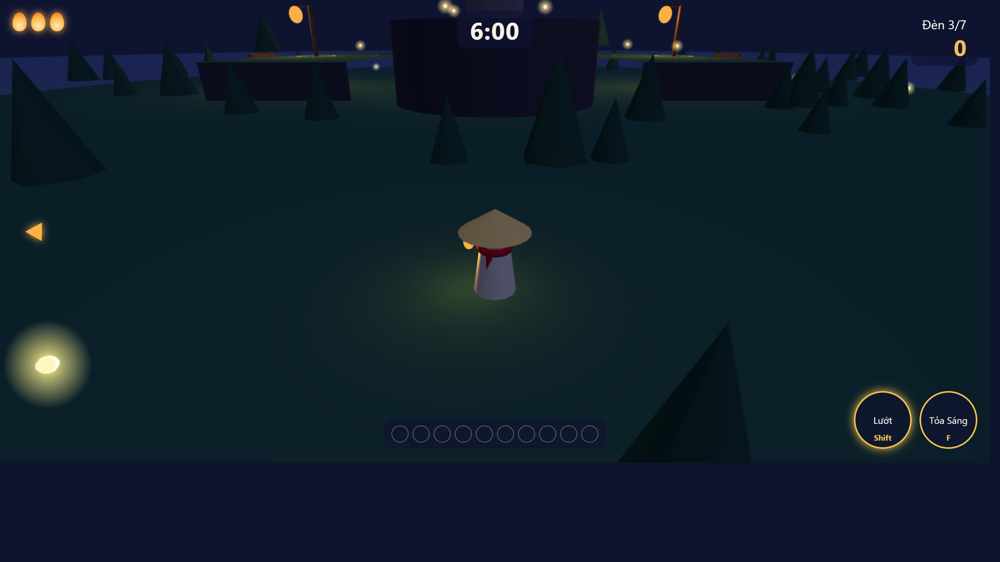

# Đảo Đèn Lồng

> **Video demo:** _(sẽ thêm ở Phase 4 — Release `v1.0.0`)_
> Đề bài lab: [lab board](https://claude.ai/artifact/Q1RYyv1dxjUczzCbd2ZnoW) · [GUIDE](GUIDE.md) · [RUBRIC](RUBRIC.md) · [SUBMISSION](SUBMISSION.md) · [RULES](RULES.md) · [CHECKPOINTS](CHECKPOINTS.md)

Game 3D góc nhìn thứ ba (Three.js, chạy trên trình duyệt). Mây, người giữ đèn nhỏ tuổi đội nón lá có treo một chiếc đèn lồng nhỏ, gom đom đóm để thắp lại các Đèn Lồng Lớn qua **3 Đêm**: Đảo Bến, Đảo Cau, Đảo Chuông. Mây phải né Bóng Mực và Gió Lạc trong sương đen. Mọi luật chơi nằm trong một lõi mô phỏng tất định (`src/sim/`), dùng chung cho game có giao diện và chế độ headless theo **Test Contract v1.2**.



- **Chế độ mù màu:** vào Cài đặt, bật "Bảng màu dễ phân biệt".

## Cài đặt và chạy (macOS / Linux / Windows, cần Node.js ≥ 18)

```bash
git clone <repo-url> dao-den-long && cd dao-den-long
npm install
npm start          # mở http://localhost:8080
```

Headless (Test Contract v1.0):

```bash
node src/headless.js --seed 1 --night 1|2|3 --ticks 3600 --out out.jsonl [--scenario s.json] [--inputs i.json] [--snapshot-every 10]
```

Kiểm chứng: `npm test` (42 test: luật chơi, tính năng Ticket-02, nhiên liệu Ticket-03, contract) · `npm run proof` (chạy CLI thật trên các scenario, ghi [docs/proof/phase-3/results.md](docs/proof/phase-3/results.md)). Đếm FPS: mở `http://localhost:8080/?autostart=1&night=3&fps`.

## Điều khiển

| Phím | Hành động |
|---|---|
| W A S D / phím mũi tên | Di chuyển theo hướng camera |
| Di chuột / Z, C | Xoay camera: bấm vào màn chơi một lần để khóa chuột, sau đó chỉ cần di chuột (Esc để nhả chuột và tạm dừng; độ nhạy chỉnh trong Cài đặt) |
| Cuộn chuột | Đưa camera ra xa / lại gần (4–22 m) |
| Space | Nhảy |
| Shift | Lướt (14 m/s trong 0,2 s, hồi chiêu 1,5 s) |
| E | Nạp đom đóm vào đèn gần nhất (trong 2 m) |
| F / chuột phải | Tỏa Sáng: tốn 3 đom đóm, choáng 2 s và đẩy lùi 4 m mọi Bóng Mực trong 5 m (hồi chiêu 3 s) |
| Esc / P | Tạm dừng: Tiếp tục / Chơi lại Đêm / Cài đặt / Về menu |
| Enter | Bắt đầu, sang Đêm tiếp theo, chơi lại |

## Luật chơi và cách tính điểm (Ticket-03, Contract v1.2)

- Có 3 Đêm:
  - Đảo Bến: 5 đèn, 240 s.
  - Đảo Cau: 6 đèn trên hai đảo nối bằng cầu tre, có bục nhảy, 270 s.
  - Đảo Chuông: 7 đèn trên 3 tầng, có dốc, bục nhảy, tháp chuông và gió mạnh, 300 s.
- **Mục tiêu: giữ đảo sáng tới bình minh.** Đêm chỉ kết thúc khi hết giờ. Lúc đó, nếu Mây còn sống và số đèn đang sáng ≥ ceil(0,6 × tổng đèn) thì **thắng**: Đêm 1 cần 3/5, Đêm 2 cần 4/6, Đêm 3 cần 5/7. Thắp đủ đèn sớm không kết thúc Đêm.
- **Đèn có dầu** (tối đa 100, hao 1 mỗi giây):
  - Thắp lần đầu cần 10 đom đóm.
  - Đèn hết dầu sẽ tắt; thắp lại chỉ cần 5 đom đóm.
  - Bấm **E** ở đèn đang sáng để châm dầu: mỗi đom đóm thêm 10 dầu.
- **Đèn yếu (dầu dưới 30):** đèn mất vùng an toàn 6 m, nhấp nháy, và Bóng Mực sẽ tới **hút dầu** (5 mỗi giây).
- **Sức chứa đom đóm** = 10 + 2 × số lần thắp thành công trong Đêm, tối đa 20.
- **Nguy hiểm:**
  - Bị Bóng Mực chạm: mất 1 Ngọn Lửa, đom đóm rơi một nửa ra đất.
  - Rơi khỏi đảo: mất 1 Ngọn Lửa và toàn bộ đom đóm.
  - Gió Lạc (Đêm 2–3) cướp tối đa 3 đom đóm.
- **Bùa Gió:** chạy nhanh và lướt không hồi chiêu trong 10 s.
- Hết Ngọn Lửa là thua ngay. Thua thì được chơi lại Đêm đó.

| Sự kiện | Điểm |
|---|---|
| Mỗi đom đóm nạp vào đèn (thắp mới, thắp lại, châm dầu) | +5 |
| Thắp lần đầu / thắp lại | +100 / +40 |
| Mỗi Bóng Mực trúng Tỏa Sáng | +5 (+15 nếu nó đang hút dầu) |
| Bình minh (chỉ khi thắng): mỗi đèn đang sáng | +50 + floor(dầu) |
| Bình minh (chỉ khi thắng): mỗi Ngọn Lửa còn lại | +50 |

Tổng điểm là tổng điểm các Đêm đã thắng. Mọi con số nằm trong [src/sim/tuning.js](src/sim/tuning.js) và được khai báo y hệt trong [game.contract.json](game.contract.json) (test CT-01). Bản đồ chuẩn nằm trong [src/sim/maps.js](src/sim/maps.js). Thay đổi phá vỡ tương thích được liệt kê trong [CHANGELOG.md](CHANGELOG.md), quyết định thiết kế trong [ADR 0001](docs/adr/0001-lantern-fuel-and-dawn-win.md).

## Sáng tạo của tôi

Tất cả chỉ nằm trong `src/web/` (phần hiển thị) và không chạm vào `src/sim/`, nên đầu ra headless không đổi. Bằng chứng: `npm test` và `npm run proof` chỉ chạy lõi mô phỏng và vẫn đạt toàn bộ (xem [results.md](docs/proof/phase-1/results.md)).

- **Đèn trời:** khi một Đèn Lồng Lớn sáng lại, 6 chiếc đèn trời bay lên từ cột đèn.
- **Đom đóm quanh nón:** số đom đóm Mây đang mang bay vòng quanh chiếc nón lá, nhìn là biết đang mang bao nhiêu.
- **Đảo sáng dần:** sương chuyển từ tím đen sang xanh ấm và ánh sáng chung tăng theo số đèn đã thắp.
- **Âm thanh tổng hợp bằng WebAudio** (không dùng file âm thanh), gồm cả nhạc nền đêm.
- **Ông Đăng:** người kể chuyện giới thiệu từng Đêm.
- **Gió Lạc mang theo đom đóm đã cướp** (nhìn thấy được), và đom đóm rơi sẽ nhấp nháy khi sắp tan.

## Cấu trúc

```text
src/sim/       luật chơi (thuần JS, tất định, không DOM): tuning.js, maps.js, sim.js, runner.js
src/headless.js  CLI theo Test Contract v1.0
src/web/       Three.js: hiển thị, input, HUD, âm thanh
tests/         test nghiệm thu (AC-xx) và test contract (CT-xx), scenario mẫu
scripts/       serve.js (server tĩnh), bot.js (tự chơi), proof.js (sinh bằng chứng)
docs/notes/    giả định, tiêu chí nghiệm thu, nhật ký dùng AI, đánh giá từng phase
docs/proof/    bằng chứng từng phase
AGENTS.md, CLAUDE.md, .claude/   harness AI: hướng dẫn, skill verify-game, hook Stop chạy test
```

Ghi chép: [Phase 1](docs/notes/phase-1.md) · [Phase 2](docs/notes/phase-2.md) · [Phase 3](docs/notes/phase-3.md) · Bằng chứng: [Phase 1](docs/proof/phase-1/README.md) · [Phase 2](docs/proof/phase-2/README.md) · [Phase 3](docs/proof/phase-3/README.md) · Nguồn: [CREDITS.md](CREDITS.md) · Giấy phép: [LICENSE](LICENSE)
