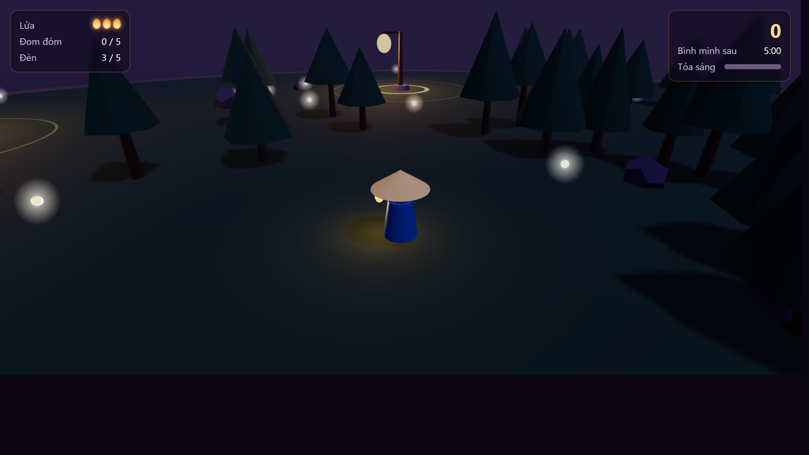

# Đảo Đèn Lồng

> **Video demo:** _(sẽ thêm ở Phase 4 — Release `v1.0.0`)_
> Đề bài lab: [lab board](https://claude.ai/artifact/Q1RYyv1dxjUczzCbd2ZnoW) · [GUIDE](GUIDE.md) · [RUBRIC](RUBRIC.md) · [SUBMISSION](SUBMISSION.md) · [RULES](RULES.md) · [CHECKPOINTS](CHECKPOINTS.md)

Game 3D góc nhìn thứ ba (Three.js, chạy trên trình duyệt). Mây, người giữ đèn nhỏ tuổi đội nón lá có treo một chiếc đèn lồng nhỏ, gom đom đóm để thắp lại 5 Đèn Lồng Lớn của **Đêm 1 – Đảo Bến** và né Bóng Mực trong sương đen. Mọi luật chơi nằm trong một lõi mô phỏng tất định (`src/sim/`), dùng chung cho game có giao diện và chế độ headless theo **Test Contract v1.0**.



## Cài đặt và chạy (macOS / Linux / Windows, cần Node.js ≥ 18)

```bash
git clone <repo-url> dao-den-long && cd dao-den-long
npm install
npm start          # mở http://localhost:8080
```

Headless (Test Contract v1.0):

```bash
node src/headless.js --seed 1 --night 1 --ticks 3600 --out out.jsonl [--scenario s.json] [--inputs i.json] [--snapshot-every 10]
```

Kiểm chứng: `npm test` (22 test nghiệm thu và contract) · `npm run proof` (chạy CLI thật trên các scenario, ghi [docs/proof/phase-1/results.md](docs/proof/phase-1/results.md)).

## Điều khiển

| Phím | Hành động |
|---|---|
| W A S D / phím mũi tên | Di chuyển theo hướng camera |
| Kéo chuột / Z, C | Xoay camera |
| Space | Nhảy |
| E | Nạp đom đóm đang mang vào đèn gần nhất (trong bán kính 3 m) |
| F / chuột phải | Tỏa sáng: tốn 1 đom đóm, đẩy lùi 4 m và làm choáng 2 s mọi Bóng Mực trong bán kính 6 m (hồi chiêu 1 s) |
| M | Bật/tắt âm thanh |
| Enter / R | Bắt đầu, chơi lại sau khi thắng hoặc thua |

## Luật chơi và cách tính điểm

- Mang tối đa **5** đom đóm. Mỗi đèn cần **5** đom đóm. Thắp đủ **5 đèn** là thắng.
- Bóng Mực đuổi theo Mây với tốc độ 3,5 m/s (Mây chạy 6 m/s). Bị chạm thì mất **1 lửa** (máu), rơi mất một nửa số đom đóm đang mang (làm tròn xuống), rồi được bất tử 1,5 s. Hết 3 lửa là thua.
- Bóng Mực **không bao giờ vào trong bán kính 6 m quanh bất kỳ đèn nào**, nên đứng cạnh đèn là an toàn.
- Đêm dài **5 phút**. Hết giờ (bình minh) mà chưa thắp hết đèn là thua.

| Sự kiện | Điểm |
|---|---|
| Nhặt 1 đom đóm | +10 |
| Thắp sáng 1 đèn | +100 |
| Mỗi Bóng Mực bị choáng bởi một lần tỏa sáng | +20 |
| Khi **thắng**: mỗi giây còn lại (làm tròn xuống) | +1 |
| Khi **thắng**: mỗi lửa còn lại | +50 |

Mọi con số nằm trong [src/sim/tuning.js](src/sim/tuning.js) và được khai báo y hệt trong [game.contract.json](game.contract.json) (test CT-01 kiểm tra hai nơi khớp nhau). `fall_enabled: false`: mép đảo là tường vô hình nên không thể rơi khỏi đảo, và không có sự kiện `player_hit` với `by: "fall"`.

## Sáng tạo của tôi

Tất cả chỉ nằm trong `src/web/` (phần hiển thị) và không chạm vào `src/sim/`, nên đầu ra headless không đổi. Bằng chứng: `npm test` và `npm run proof` chỉ chạy lõi mô phỏng và vẫn đạt toàn bộ (xem [results.md](docs/proof/phase-1/results.md)).

- **Đèn trời:** khi một Đèn Lồng Lớn sáng lại, 6 chiếc đèn trời bay lên từ cột đèn.
- **Đom đóm quanh nón:** số đom đóm Mây đang mang bay vòng quanh chiếc nón lá, nhìn là biết đang mang bao nhiêu.
- **Đảo sáng dần:** sương chuyển từ tím đen sang xanh ấm và ánh sáng chung tăng theo số đèn đã thắp.
- **Âm thanh tổng hợp bằng WebAudio** (không dùng file âm thanh): nhặt đom đóm, nạp đèn, thắp đèn, tỏa sáng, bị chạm.

## Cấu trúc

```text
src/sim/       luật chơi (thuần JS, tất định, không DOM): tuning.js, sim.js, runner.js
src/headless.js  CLI theo Test Contract v1.0
src/web/       Three.js: hiển thị, input, HUD, âm thanh
tests/         test nghiệm thu (AC-xx) và test contract (CT-xx), scenario mẫu
scripts/       serve.js (server tĩnh), bot.js (tự chơi), proof.js (sinh bằng chứng)
docs/notes/    giả định, tiêu chí nghiệm thu, nhật ký dùng AI, đánh giá từng phase
docs/proof/    bằng chứng từng phase
AGENTS.md, CLAUDE.md, .claude/   harness AI: hướng dẫn, skill verify-game, hook Stop chạy test
```

Ghi chép Phase 1: [docs/notes/phase-1.md](docs/notes/phase-1.md) · Bằng chứng: [docs/proof/phase-1/README.md](docs/proof/phase-1/README.md) · Nguồn: [CREDITS.md](CREDITS.md) · Giấy phép: [LICENSE](LICENSE)
